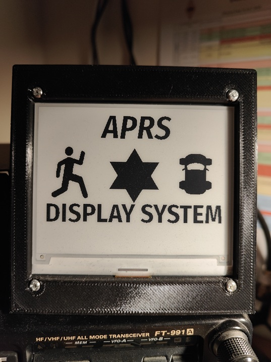
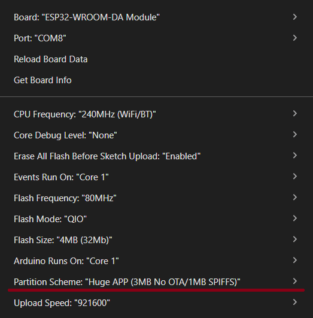

# APRS_Display_System 2.0

This is an advanced, multi-functional APRS (Automatic Packet Reporting System) frame display based on the ESP32-WROOM microcontroller. It receives, decodes and displays radio (or internet) frames on a low-power e-ink screen (WeAct 4.2" BW).

[Polska wersja / Polish version](READMEPL.md)

## Highlights
* **Four data interfaces:** VP-Digi (UART/KISS), KISS TCP (e.g. Direwolf), APRS-IS and Bluetooth SPP (HC-05).
* **Three screen modes:** classic (compass), station list and statistics with "DX of the day".
* **Full APRS symbol set** – about 190 icons from the `/` and `\` tables plus overlays (e.g. `L#`), matching aprs.fi.
* **Polish characters on e-paper** – pixel-designed U8g2 fonts.
* **APRS messaging** – automatic acknowledgement (ACK) of incoming messages and sending from the web panel.
* **Web panel** with a station map, statistics, messages and a live terminal.
* **Beacon** with your own position (RF or APRS-IS).
* **Resilience** – WiFi recovery after a router outage, fallback access point, APRS-IS stall detection, last reset reason shown on screen.

## Installation
1. Download the repository and **rename the folder to `APRS_Display_v2`**. The Arduino IDE requires the folder name to match the main file `APRS_Display_v2.ino`. If you keep the name `APRS_Display_System`, the IDE offers to move only the `.ino` file into a new folder and the other project files will no longer be found.
2. Install the libraries (Tools → Manage Libraries):
   * **GxEPD2**
   * **Adafruit GFX Library**
   * **U8g2_for_Adafruit_GFX**
3. Install the ESP32 board package (Espressif, tested with 3.3.x) and select **ESP32 Dev Module**.
4. In the Tools menu select the **Huge APP (3MB No OTA/1MB SPIFFS)** partition scheme, as shown in the image.
5. Open `APRS_Display_v2.ino` (the other files open as tabs), compile and upload. After a moment the welcome screen with a progress bar and version number appears.



## First start
* Without WiFi configured, the device starts its own network **`APRS_DISPLAY_SETUP`** with the password **`aprsdisplay`**. Connect to it and open **http://192.168.4.1** – the instructions also stay on the screen.
* In the panel set your callsign, position, WiFi network and data interface, then click "Zapisz i Zrestartuj" (save and restart).
* Once connected to your home network, the panel's IP address is shown in the screen footer.

## Data interfaces
* **VP-Digi UART (hardware TNC):** KISS frames directly from the RX/TX pins of an external modem (e.g. VP-Digi). 4 KB receive buffer – no frames are lost during e-paper refresh.
* **KISS TCP:** the ESP32 connects over WiFi to a KISS TCP server (e.g. Direwolf on a Raspberry Pi). Frames from any TNC port are accepted.
* **APRS-IS:** connection to the APRS-IS network (e.g. poland.aprs2.net). The passcode is calculated automatically from the callsign (the field can be left empty). The server filter is built from your position and the distance filter (100 km when set to "0 = off"), or you can enter your own. A silently dropped connection (no data for > 90 s) is re-established.
* **Bluetooth SPP (HC-05 client):** wireless connection to a modem fitted with an HC-05 module. **WiFi is disabled in Bluetooth mode.**

## Screen (4.2" e-ink)
* **Classic mode:** large callsign of the last station with its APRS symbol, a compass showing the direction, distance, decoded data (or the raw frame / comment only), the two previous stations, plus the radio model and DX of the day in the bottom-right corner.
* **List mode:** up to 6 recent stations with symbol, distance, direction, radio model and time since reception ("teraz" = now, "5min"). DX of the day in the title bar.
* **Statistics mode:** DX of the day with time, stations heard in 1 h and 24 h, packet counter, uptime, clock and the last message.
* **Footer:** callsign, interface and IP address; an **MSG** badge for unread messages (cleared when the web panel is viewed).
* **EMCOM:** EMERGENCY frames (the word in capitals or Mic-E "Emergency" status) bypass all filters, show an alarm, force a full refresh and lock the screen for one minute.
* U8g2 fonts (Helvetica) with Polish characters; text is wrapped and trimmed by its real pixel width.

## DX of the day
* The farthest station received that day, reset at midnight (time from NTP; time zone set in the panel).
* Only stations heard **directly** count – no digipeater (no path element marked `*`) and no frames relayed by an iGate. In APRS-IS mode – stations heard directly by the iGate.
* Objects and items are ignored (their position is not where the transmission came from).
* DX is also taken from frames rejected by the distance filter.

## APRS messaging
* Messages addressed to your callsign (or your APRS-IS callsign) are acknowledged automatically (ACK, can be disabled); retransmissions from the sender are not shown twice.
* Messages (up to 67 characters) can be sent from the web panel. They are retried every 30 s, up to 5 times, until acknowledged.
* Plain ASCII is transmitted on air (Polish characters are transliterated), as the APRS specification requires.

## Web panel
* Configuration of all options, statistics, messages with a send form and a live terminal with raw frames and logs.
* **Station map** ("Mapa stacji" tab) – heard stations on an OpenStreetMap map with distance, radio and comment. Needs internet access in the browser.
* JSON API: `/api/status` (statistics and messages) and `/api/stations` (stations with positions).
* **Security:** fallback network password (default `aprsdisplay`, min. 8 characters), optional panel password (user `admin`). Stored passwords are never sent back to the browser – an empty field means "unchanged".

## Frame decoding
* AX.25 in KISS frames and APRS-IS lines, third-party traffic from iGates (`}`).
* Standard and compressed positions (Base91 – with course, speed and altitude), Mic-E (with altitude, frequency and status), objects and items, weather (with and without position), PHG, status, messages.
* Radio identification by TOCALL and Mic-E suffixes (Yaesu, Kenwood, AnyTone, APRSdroid, Direwolf, aprx, APRSIS32, UI-View, Xastir, MicroSat, LoRa and others).
* Distance and bearing from your position to the station.

## Filters and extras
* **Anti-duplicate:** identical frames from the same station within 10 s are ignored (digipeater retransmissions).
* **Distance filter:** reject stations farther than a set limit.
* **Hide frames without a position.**
* **Beacon:** your position, symbol and comment at a set interval; configurable RF path (e.g. `WIDE1-1,WIDE2-1`), first beacon one minute after start.

## Fail-safe mechanisms
* **WiFi recovery:** when the router starts slower than the ESP32 (e.g. after a power cut), the device starts the fallback network and keeps retrying the home network in the background. The fallback network switches off by itself once connected.
* **BT auto-fallback:** if the ESP32 fails to connect to the HC-05 three times in Bluetooth mode, it restarts into fallback network mode. After 10 minutes with nobody in the panel it tries Bluetooth again.
* **Reset reason:** after a restart caused by an error (brownout, program crash, watchdog) the reason is shown on the boot screen and written to the panel terminal.

## Hardware connection diagram (pinout)
The e-ink screen uses the SPI bus, while the TNC requires a hardware serial port (UART2). The table below shows how to connect the ESP32 board (WROOM-32 / DevKit) to the e-ink display (e.g. Waveshare / GxEPD2 4.2"). The ESP32 has hardware pins assigned for SPI (SCK and MOSI); the remaining control pins are defined in the code.

| Pin on e-ink module | Pin on ESP32 | Description (function) |
|--|--|--|
| VCC | 3.3V | Display logic power supply (never 5V!) |
| GND | GND | Common ground |
| SDA | GPIO 23 | Data from ESP to the display (hardware SPI) |
| SCL | GPIO 18 | Bus clock (hardware SPI) |
| CS | GPIO 5 | Defined in code as EPD_CS |
| DC | GPIO 17 | Defined in code as EPD_DC |
| RST | GPIO 16 | Defined in code as EPD_RST |
| BUSY | GPIO 4 | Defined in code as EPD_BUSY |

### Hardware modem (VP-Digi / TNC) ↔ ESP32 (UART mode)
The connection uses the ESP32 hardware serial port and requires a crossover (TX to RX).

| Modem pin (e.g. VP-Digi) | Pin on ESP32 | Description (function) |
|--|--|--|
| TX (TNC transmit) | GPIO 26 | Defined as VP_RX_PIN (ESP32 receives data) |
| RX (TNC receive) | GPIO 27 | Defined as VP_TX_PIN (ESP32 sends beacons and messages) |
| GND (ground) | GND | A common ground between the boards is absolutely critical! |

### Bluetooth module (HC-05 connected to the radio)
* Connect the HC-05 with RX/TX wires to your mobile modem/radio (e.g. the DATA port).
* The ESP32 connects to the HC-05 wirelessly, using the MAC address entered in the web panel.
* **Note: WiFi is disabled in Bluetooth mode!**

## File structure
| File | Contents |
|--|--|
| `APRS_Display_v2.ino` | globals, configuration, `setup()`, `loop()` |
| `display.ino` | e-ink drawing (3 modes, boot screen, symbols) |
| `network.ino` | KISS/UART/BT/TCP/APRS-IS, beacon, filters, WiFi |
| `messages.ino` | messaging with ACK and retries |
| `stats.ino` | statistics and DX of the day |
| `web.ino` | web panel, map, JSON API |
| `aprs_parser.h/.cpp` | APRS frame decoder (no hardware dependencies) |
| `app.h` | shared types, constants and declarations |
| `icons.h` | boot screen logo |
| `icons_aprs.h` | 32×32 APRS symbols (generated) |
| `tools/convert-icons.ps1` | generator of `icons_aprs.h` from the PNG sheets |
| `test/` | parser and symbol tests for PC |

## Tests
The parser and symbol tables have tests that run on a PC:
```
g++ -std=c++17 -Itest/arduino_shim -I. test/test_parser.cpp aprs_parser.cpp -o test_parser && ./test_parser
```
On every push GitHub Actions runs the tests and builds the firmware (the `.bin` file is available as a build artifact).

## APRS symbols – source and license
The icons come from the aprs.fi symbol set – [hessu/aprs-symbols](https://github.com/hessu/aprs-symbols) (Heikki Hannikainen OH7LZB and other authors). The license of each symbol is described in [COPYRIGHT.md](https://github.com/hessu/aprs-symbols/blob/master/COPYRIGHT.md): some are CC BY-SA, some are public domain, and for some (derived from the classic UI-View/WA8LMF set) the license is unknown to the author. Company logos (`/M`, `/Z`, `\K`) are left out – a frame with the symbol character is shown instead. The colour icons are converted to 32×32 black and white by `tools/convert-icons.ps1` (outlines in black, fills as a 50% checkerboard).

## Planned features
* Button support (going back through frames, scrolling the list)

## Info
* Software: Mateusz SP3WRO czysty61@gmail.com
* Case: Patryk patrykst1999@o2.pl
