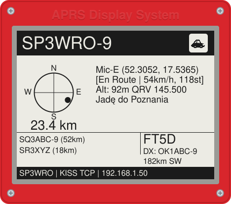
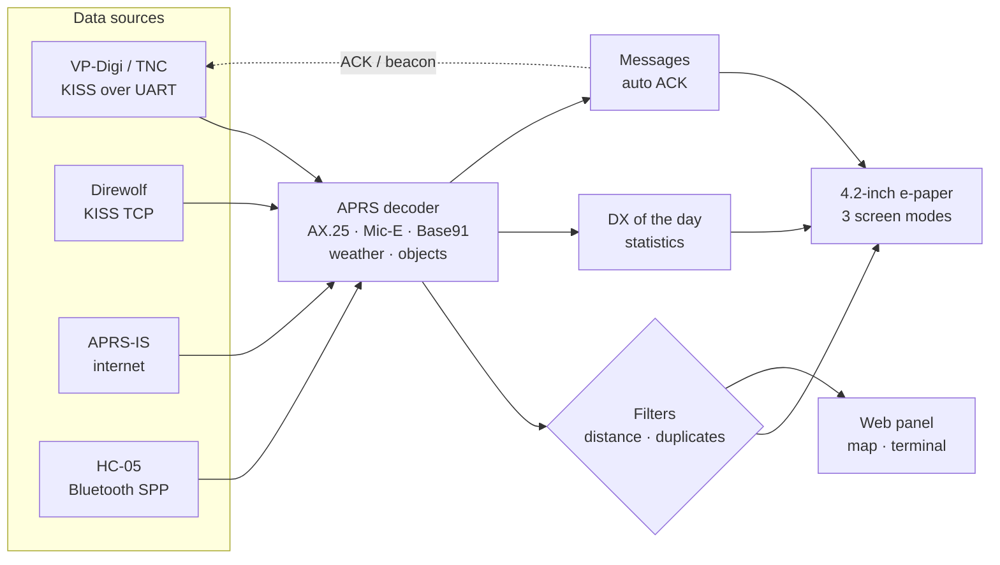
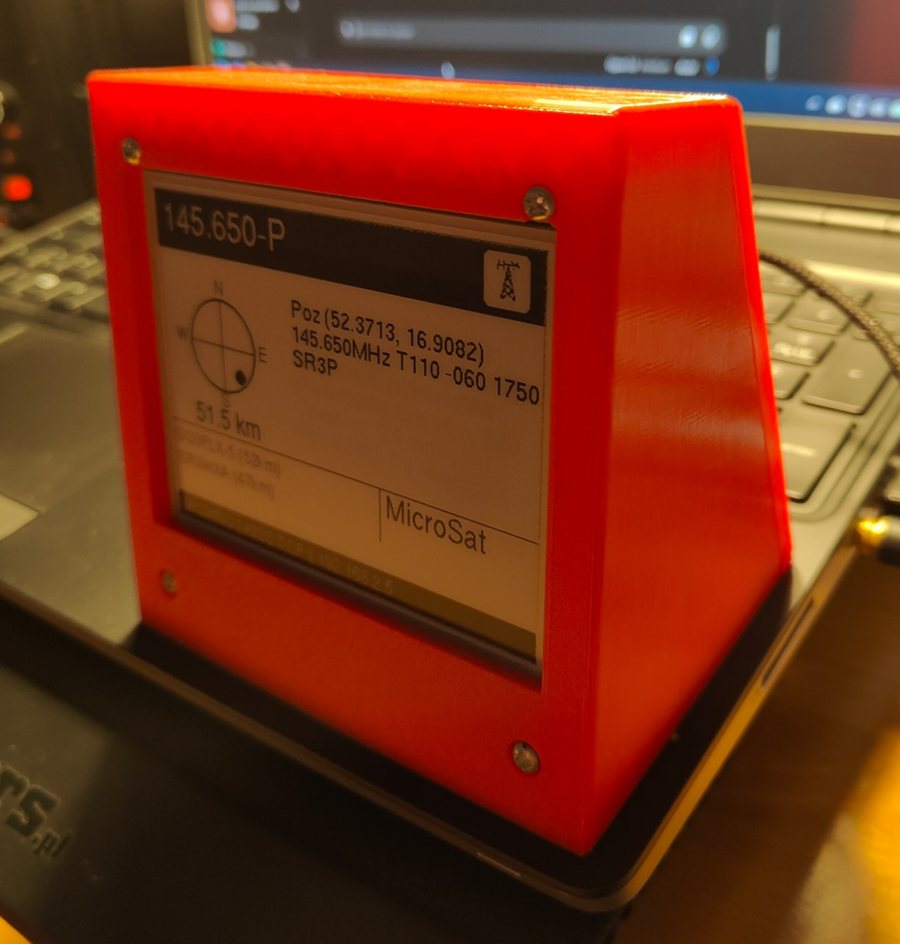
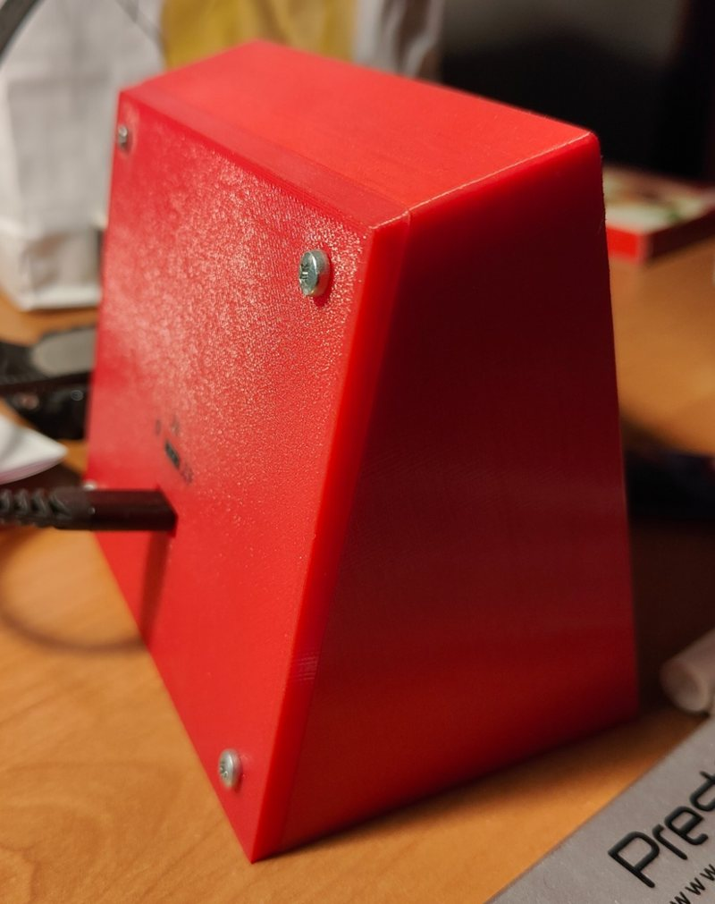

<p align="center">
  
</p>

<p align="center">
  <a href="https://github.com/SP3WRO/APRS_Display_System/actions/workflows/build.yml"></a>
  
  
  
  
</p>

<p align="center">
  <a href="READMEPL.md">🇵🇱 Polski</a> · <b>🇬🇧 English</b>
</p>

**APRS Display System** is a standalone APRS traffic display built on an ESP32 and a low-power 4.2" e-paper screen. It receives frames from the radio (via a KISS modem or Bluetooth) or from the internet (APRS-IS), decodes them and shows what matters: who is transmitting, how far away and in which direction, what they are driving and what they have to say. Configuration and live monitoring happen in a web browser – nothing to install.

<p align="center">
  
</p>

> The on-device user interface is in Polish.

---

## Table of contents
- [Features](#features)
- [Screen modes](#screen-modes)
- [How it works](#how-it-works)
- [Hardware](#hardware)
- [Wiring](#wiring)
- [Installation](#installation)
- [First start](#first-start)
- [Web panel](#web-panel)
- [How it works in detail](#how-it-works-in-detail)
- [For developers](#for-developers)
- [License and credits](#license-and-credits)

---

## Features

| Feature | Description |
|--|--|
| 📡 **Four data sources** | VP-Digi modem (UART/KISS), KISS TCP (e.g. Direwolf), APRS-IS over WiFi and Bluetooth SPP (HC-05). |
| 🖥️ **Three screen modes** | Classic with a compass, a list of recent stations and statistics with DX of the day. Switched from the web panel instantly, without a restart. |
| 🧭 **Distance and bearing** | Distance and azimuth from your station, with a compass pointing the way. |
| 🏷️ **Full APRS symbol set** | About 190 icons from the primary and alternate tables plus overlays (e.g. `L#`), matching aprs.fi. |
| 🏆 **DX of the day** | The farthest station heard directly (no digipeaters), reset at midnight. |
| ✉️ **APRS messaging** | Incoming messages are acknowledged automatically (ACK); send messages from the browser, retried until acknowledged. |
| 🔤 **Polish characters** | Pixel-designed fonts, crisp on e-paper, with full Polish character support. |
| 🌐 **Web panel and map** | All settings, statistics, messages, a live terminal and a map of heard stations. |
| 📍 **Beacon** | Your own position with the chosen symbol and comment, over RF or APRS-IS. |
| 🚨 **EMCOM** | EMERGENCY frames bypass all filters and raise an on-screen alarm. |
| 🛡️ **Resilience** | WiFi recovery after a router outage, fallback setup network, stalled connection detection, last reset reason on screen. |

---

## Screen modes

<table>
  <tr>
    <td align="center" width="33%"></td>
    <td align="center" width="33%"></td>
    <td align="center" width="33%"></td>
  </tr>
  <tr>
    <td valign="top"><b>Classic</b><br>Callsign and symbol of the last station, compass with direction, distance, decoded data (or the raw frame / comment only), two previous stations, radio model and DX of the day.</td>
    <td valign="top"><b>Station list</b><br>The six most recent stations with symbol, distance, direction, radio model and time since reception. DX of the day in the title bar.</td>
    <td valign="top"><b>Statistics</b><br>DX of the day with time, stations heard in the last hour and day, packet counter, uptime, clock and the last message.</td>
  </tr>
</table>

> The visualisations follow the layout from the device code (same coordinates and icons). The **MSG** badge in the footer signals unread messages.

---

## How it works



---

## Hardware

| Part | Description |
|--|--|
| **ESP32** | ESP32-WROOM-32 board (DevKit). |
| **Display** | WeAct 4.2" e-paper BW, 400×300 px (GDEY042T81 driver), SPI. |
| **Data source** *(one of)* | VP-Digi modem or another KISS TNC · Direwolf on the network · internet access (APRS-IS) · HC-05 module at the radio. |
| **Enclosure** | 3D printed, files `case/1.stl` and `case/2.stl` (design: Patryk Starzonek). |
| **Power** | 5 V over USB. |

<p align="center">
  
  
</p>

> 💡 **Power supply:** when WiFi starts, the ESP32 briefly draws several hundred mA. The firmware limits these peaks (lower WiFi transmit power, CPU at 160 MHz), but if the device reports a brownout ("SPADEK NAPIĘCIA") at start-up, a 470–1000 µF capacitor between 3.3 V and GND next to the ESP32 and a short, thick USB cable will help.

---

## Wiring

<p align="center">
  
</p>

<details>
<summary><b>Connection tables</b></summary>

**E-ink display ↔ ESP32** (SPI)

| Display pin | ESP32 pin | Function |
|--|--|--|
| VCC | 3.3 V | Display logic supply, **never 5 V** |
| GND | GND | Common ground |
| SDA (DIN) | GPIO 23 | Data (hardware SPI, MOSI) |
| SCL (CLK) | GPIO 18 | Clock (hardware SPI, SCK) |
| CS | GPIO 5 | `EPD_CS` |
| DC | GPIO 17 | `EPD_DC` |
| RST | GPIO 16 | `EPD_RST` |
| BUSY | GPIO 4 | `EPD_BUSY` |

**VP-Digi modem / TNC ↔ ESP32** (UART2, crossover)

| Modem pin | ESP32 pin | Function |
|--|--|--|
| TX | GPIO 26 | `VP_RX_PIN`, the ESP32 receives frames |
| RX | GPIO 27 | `VP_TX_PIN`, the ESP32 sends beacons, ACKs and messages |
| GND | GND | Common ground – mandatory |

**Bluetooth (HC-05)** – wire the module's RX/TX to the modem at the radio (e.g. the DATA port); the ESP32 connects to it wirelessly using the MAC address set in the panel. WiFi is disabled in Bluetooth mode.

</details>

---

## Installation

1. **Download the project** (Code → Download ZIP or `git clone`) and **rename the folder to `APRS_Display_v2`**.
   > The Arduino IDE requires the folder to be named like the main file `APRS_Display_v2.ino`. With another name the IDE moves only the `.ino` file and the rest of the project is no longer found.
2. **Install the libraries** (Tools → Manage Libraries):
   - `GxEPD2`
   - `Adafruit GFX Library`
   - `U8g2_for_Adafruit_GFX`
3. **Install the ESP32 board package** (Espressif, tested with 3.3.x) and select your ESP32 board.
4. **Select the "Huge APP (3MB No OTA/1MB SPIFFS)" partition scheme**:
   <p></p>
5. **Open `APRS_Display_v2.ino`** (the other files open as tabs), compile and upload. The boot screen with a progress bar and the version number appears.

> A ready-made `.bin` file for every version is also available as an artifact in [GitHub Actions](https://github.com/SP3WRO/APRS_Display_System/actions/workflows/build.yml).

---

## First start

1. Without WiFi configured, the device starts its own network **`APRS_DISPLAY_SETUP`** with the password **`aprsdisplay`**. The instructions also stay on the screen.
2. Connect to that network and open **http://192.168.4.1**.
3. Set your callsign, position, WiFi network and data source, then click **Zapisz** (save).
4. Once connected to your home network, the panel address is shown in the screen footer.

---

## Web panel

- **Settings** for every feature. The screen mode and data format change **as soon as you pick them from the list**, and the save button restarts the device only when the connection changes (data source, WiFi, server, Bluetooth). Everything else applies immediately.
- **Statistics** – DX of the day, station count, packet counter.
- **Messages** – received and sent messages with acknowledgements, plus a send form.
- **Station map** – heard stations on an OpenStreetMap map with distance, radio and comment (needs internet access in the browser).
- **Live terminal** – raw frames and device logs.
- **JSON API** – `/api/status` and `/api/stations` for your own integrations.
- **Security** – fallback network password and an optional panel password (user `admin`). Stored passwords are never sent back to the browser.

---

## How it works in detail

<details>
<summary><b>📡 Data sources</b></summary>

- **VP-Digi UART** – KISS frames from the modem's RX/TX pins. A 4 KB buffer keeps frames from being lost while the screen refreshes.
- **KISS TCP** – client of a KISS server (e.g. Direwolf on a Raspberry Pi). Frames from any TNC port are accepted.
- **APRS-IS** – passcode calculated automatically from the callsign. The server filter is built from your position and the distance filter (100 km when set to "0 = off") or entered manually; filter changes apply without reconnecting. A silently dropped connection (no data for 90 s) is re-established.
- **Bluetooth SPP** – connection to a modem fitted with an HC-05. After three failed attempts the device switches to the fallback network and retries Bluetooth after 10 minutes with nobody in the panel.
</details>

<details>
<summary><b>🧩 Frame decoding</b></summary>

- AX.25 in KISS frames, APRS-IS lines, traffic relayed by iGates (`}`).
- Standard and compressed positions (Base91 – with course, speed and altitude), Mic-E (with altitude, frequency and status), objects and items, weather with and without position, PHG, status, messages.
- Radio identification by TOCALL and Mic-E suffixes: Yaesu, Kenwood, AnyTone, APRSdroid, Direwolf, aprx, APRSIS32, UI-View, Xastir, MicroSat, LoRa and more.
</details>

<details>
<summary><b>🏆 DX of the day</b></summary>

- The farthest station of the day, reset at midnight (time from NTP, time zone set in the panel).
- Only stations heard **directly** count: no digipeater (no path element marked `*`) and no frames relayed by an iGate. In APRS-IS mode – stations heard directly by the iGate.
- Objects and items are ignored, as their position is not where the transmission came from.
- DX is also taken from frames rejected by the distance filter.
</details>

<details>
<summary><b>✉️ Messaging</b></summary>

- Messages to your callsign (or your APRS-IS callsign) are acknowledged automatically (can be disabled); retransmissions from the sender are not shown twice.
- Sending from the panel: up to 67 characters, retried every 30 s, up to 5 times, until acknowledged.
- Plain ASCII is transmitted on air (Polish characters are transliterated), as the APRS specification requires.
</details>

<details>
<summary><b>🔎 Filters and beacon</b></summary>

- **Anti-duplicate** – identical frames from the same station within 10 s are ignored.
- **Distance filter** – rejects stations farther than the set limit (EMERGENCY frames always pass).
- **Hide frames without a position.**
- **Beacon** – position, symbol and comment at a set interval, configurable RF path (e.g. `WIDE1-1,WIDE2-1`), first beacon one minute after start.
</details>

<details>
<summary><b>🛡️ Fail-safe mechanisms</b></summary>

- **WiFi recovery** – when the router starts slower than the ESP32 (e.g. after a power cut), the device starts the fallback network and keeps retrying the home network in the background. The fallback network switches off by itself once connected.
- **Reset reason** – after a restart caused by an error (brownout, program crash, watchdog) the reason is shown on the boot screen and in the panel terminal.
- **Corrupted frame protection** – short or malformed frames do not hang the device (covered by tests).
</details>

---

## For developers

### Project structure

| File | Contents |
|--|--|
| `APRS_Display_v2.ino` | globals, configuration, `setup()`, `loop()` |
| `display.ino` | e-ink screen: 3 modes, boot screen, APRS symbols |
| `network.ino` | KISS / UART / Bluetooth / TCP / APRS-IS, beacon, filters, WiFi |
| `messages.ino` | messaging with ACK and retries |
| `stats.ino` | statistics and DX of the day |
| `web.ino` | web panel, map, JSON API |
| `aprs_parser.h/.cpp` | APRS frame decoder with no hardware dependencies |
| `app.h` | shared types, constants and declarations |
| `icons.h` / `icons_aprs.h` | boot logo / 32×32 APRS symbols |
| `tools/convert-icons.ps1` | generator of `icons_aprs.h` from the symbol sheets |
| `test/` | parser and symbol tests for PC |
| `case/` | enclosure STL files |

### Tests and CI

```bash
g++ -std=c++17 -Itest/arduino_shim -I. test/test_parser.cpp aprs_parser.cpp -o test_parser && ./test_parser
```

On every push [GitHub Actions](https://github.com/SP3WRO/APRS_Display_System/actions/workflows/build.yml) runs the parser tests and builds the ESP32 firmware, publishing a ready `.bin` file.

### Roadmap

- Button support (scrolling the list, going back through frames).

---

## License and credits

- Code: **GNU GPL v3** – see [LICENSE](LICENSE).
- **APRS symbols** come from the aprs.fi set – [hessu/aprs-symbols](https://github.com/hessu/aprs-symbols) (Heikki Hannikainen OH7LZB and other authors). The license of each symbol is described in [COPYRIGHT.md](https://github.com/hessu/aprs-symbols/blob/master/COPYRIGHT.md): some are CC BY-SA, some are public domain, and for some (from the classic UI-View/WA8LMF set) the license is unknown to the author. Company logos (`/M`, `/Z`, `\K`) are left out. The icons are converted to 32×32 black and white by `tools/convert-icons.ps1`.
- Fonts: [U8g2](https://github.com/olikraus/u8g2) (Oliver Kraus); display driver: [GxEPD2](https://github.com/ZinggJM/GxEPD2) (Jean-Marc Zingg).

## Authors

- **Software:** Mateusz SP3WRO – czysty61@gmail.com
- **Enclosure:** Patryk Starzonek – patrykst1999@o2.pl

<p align="center"><sub>73 de SP3WRO</sub></p>
