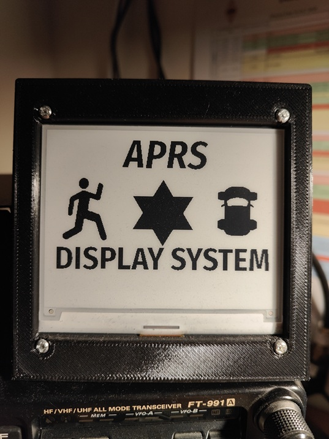
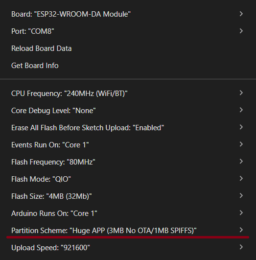

# APRS_Display_System 2.0

To zaawansowany, wielofunkcyjny wyświetlacz ramek APRS (Automatic Packet Reporting System) oparty na mikrokontrolerze ESP32-WROOM, który służy do odbierania, dekodowania i wyświetlania ramek radiowych (lub internetowych) na energooszczędnym ekranie e-ink (WeAct 4,2" BW).

## Najważniejsze funkcje
* **Cztery złącza danych:** VP-Digi (UART/KISS), KISS TCP (np. Direwolf), APRS-IS i Bluetooth SPP (HC-05).
* **Trzy tryby ekranu:** klasyczny (kompas), lista stacji i statystyki z „DX dnia”.
* **Pełny zestaw symboli APRS** – ok. 190 ikon z tabeli `/` i `\` oraz nakładki (np. `L#`), takie same jak na aprs.fi.
* **Polskie litery na e-papierze** – czcionki U8g2 rysowane piksel po pikselu.
* **Wiadomości APRS** – odbiór z automatycznym potwierdzeniem (ACK) i wysyłanie z panelu WWW.
* **Panel WWW** z mapą stacji, statystykami, wiadomościami i terminalem na żywo.
* **Beacon** z własną pozycją (RF lub APRS-IS).
* **Odporność na awarie** – powrót do WiFi po awarii routera, awaryjna sieć AP, wykrywanie zerwanego APRS-IS, przyczyna ostatniego restartu na ekranie.

## Instalacja
1. Pobierz repozytorium i **zmień nazwę folderu na `APRS_Display_v2`**. Arduino IDE wymaga, żeby folder nazywał się tak samo jak główny plik `APRS_Display_v2.ino`. Jeśli zostawisz nazwę `APRS_Display_System`, IDE zaproponuje przeniesienie samego pliku `.ino` do nowego folderu i pozostałe pliki projektu przestaną być widoczne.
2. Zainstaluj biblioteki (Narzędzia → Zarządzaj bibliotekami):
   * **GxEPD2**
   * **Adafruit GFX Library**
   * **U8g2_for_Adafruit_GFX**
3. Zainstaluj obsługę płytek ESP32 (Espressif, testowane na wersji 3.3.x) i wybierz płytkę **ESP32 Dev Module**.
4. W menu Narzędzia wybierz schemat partycji **Huge APP (3MB No OTA/1MB SPIFFS)**, tak jak na zdjęciu.
5. Otwórz `APRS_Display_v2.ino` (pozostałe pliki otworzą się jako zakładki), skompiluj i wgraj. Po chwili pojawi się ekran powitalny z paskiem ładowania i numerem wersji.



## Pierwsze uruchomienie
* Bez skonfigurowanego WiFi urządzenie uruchamia własną sieć **`APRS_DISPLAY_SETUP`** z hasłem **`aprsdisplay`**. Połącz się z nią i otwórz **http://192.168.4.1** – instrukcja zostaje też na ekranie.
* W panelu ustaw znak, swoją pozycję, sieć WiFi i złącze danych, a następnie kliknij „Zapisz i Zrestartuj”.
* Po połączeniu z domową siecią adres IP panelu widać w stopce ekranu.

## Złącza danych
* **VP-Digi UART (sprzętowy TNC):** ramki KISS bezpośrednio z pinów RX/TX zewnętrznego modemu (np. VP-Digi). Bufor odbiorczy 4 KB – ramki nie giną podczas odświeżania e-papieru.
* **KISS TCP:** ESP32 łączy się przez WiFi z serwerem KISS TCP (np. Direwolf na Raspberry Pi). Obsługiwane są ramki z dowolnego portu TNC.
* **APRS-IS:** połączenie z siecią APRS-IS (np. poland.aprs2.net). Passcode jest liczony automatycznie ze znaku (pole można zostawić puste). Filtr serwera ustawia się sam na podstawie pozycji i filtra odległości (przy „0 = wył” – 100 km) albo można wpisać własny. Zerwane „po cichu” połączenie (brak danych > 90 s) jest nawiązywane od nowa.
* **Bluetooth SPP (klient HC-05):** bezprzewodowe połączenie z modemem wyposażonym w moduł HC-05. **W trybie Bluetooth WiFi jest wyłączone.**

## Ekran (E-Ink 4,2")
* **Tryb klasyczny:** duży znak ostatniej stacji z symbolem APRS, kompas z kierunkiem do stacji, dystans, zdekodowane dane (albo surowa ramka / sam komentarz), dwie poprzednie stacje oraz model radia i DX dnia w prawym dolnym rogu.
* **Tryb listy:** do 6 ostatnich stacji z symbolem, dystansem, kierunkiem, modelem radia i czasem od odebrania („teraz”, „5min”). DX dnia na pasku tytułowym.
* **Tryb statystyk:** DX dnia z godziną, liczba stacji w ciągu 1 h i 24 h, licznik ramek, czas pracy, zegar i ostatnia wiadomość.
* **Stopka:** znak, złącze i adres IP; plakietka **MSG** przy nieprzeczytanych wiadomościach (znika po obejrzeniu panelu WWW).
* **EMCOM:** ramki z EMERGENCY (słowo pisane wielkimi literami lub status Mic-E „Emergency”) omijają wszystkie filtry, pokazują alarm na ekranie, wymuszają pełne odświeżenie i blokują ekran na minutę.
* Czcionki U8g2 (Helvetica) z polskimi literami; tekst jest zawijany i przycinany według rzeczywistej szerokości w pikselach.

## DX dnia
* Najdalsza stacja odebrana danego dnia, zerowana o północy (czas z NTP; strefa czasowa ustawiana w panelu).
* Liczy się tylko stacja słyszana **bezpośrednio** – bez digipeatera (żaden adres w ścieżce nie jest oznaczony `*`) i bez ramek przekazanych przez iGate. W trybie APRS-IS – stacja słyszana bezpośrednio przez iGate.
* Pomijane są obiekty i itemy (ich pozycja to nie miejsce nadawania).
* DX jest liczony także z ramek odrzuconych przez filtr odległości.

## Wiadomości APRS
* Wiadomości zaadresowane do Twojego znaku (lub znaku APRS-IS) są potwierdzane automatycznie (ACK – można wyłączyć), a powtórki od nadawcy nie są pokazywane drugi raz.
* Z panelu WWW można wysłać wiadomość (do 67 znaków). Jest ponawiana co 30 s, maksymalnie 5 razy, aż do potwierdzenia.
* W eter wysyłany jest czysty ASCII (polskie litery są zamieniane), zgodnie ze specyfikacją APRS.

## Panel WWW
* Konfiguracja wszystkich opcji, statystyki, wiadomości z formularzem wysyłania i terminal na żywo z surowymi ramkami i logami.
* **Mapa stacji** (zakładka „Mapa stacji”) – słyszane stacje na mapie OpenStreetMap z dystansem, radiem i komentarzem. Wymaga internetu w przeglądarce.
* API JSON: `/api/status` (statystyki i wiadomości) oraz `/api/stations` (stacje z pozycjami).
* **Bezpieczeństwo:** hasło sieci awaryjnej (domyślnie `aprsdisplay`, min. 8 znaków), opcjonalne hasło panelu (użytkownik `admin`). Zapisane hasła nigdy nie są odsyłane do przeglądarki – puste pole oznacza „bez zmian”.

## Dekodowanie ramek
* AX.25 w ramkach KISS oraz linie APRS-IS, ruch third-party z iGate (`}`).
* Pozycje standardowe, skompresowane (Base91 – z kursem, prędkością i wysokością), Mic-E (z wysokością, częstotliwością i statusem), obiekty i itemy, pogoda (z pozycją i bez), PHG, statusy, wiadomości.
* Identyfikacja radia po TOCALL i sufiksach Mic-E (Yaesu, Kenwood, AnyTone, APRSdroid, Direwolf, aprx, APRSIS32, UI-View, Xastir, MicroSat, LoRa i inne).
* Dystans i azymut od Twojej pozycji do stacji.

## Filtry i funkcje dodatkowe
* **Anty-duplikat:** identyczne ramki tej samej stacji w ciągu 10 s są ignorowane (retransmisje digipeaterów).
* **Filtr dystansu:** odrzucanie stacji dalszych niż zadany limit.
* **Ukrywanie ramek bez pozycji.**
* **Beacon:** własna pozycja, symbol i komentarz w zadanym odstępie; konfigurowalna ścieżka RF (np. `WIDE1-1,WIDE2-1`), pierwszy beacon minutę po starcie.

## Mechanizmy awaryjne
* **Powrót do WiFi:** gdy router startuje wolniej niż ESP32 (np. po zaniku prądu), urządzenie uruchamia sieć awaryjną i w tle ponawia łączenie z domową siecią. Po odzyskaniu połączenia sieć awaryjna wyłącza się sama.
* **BT Auto-Fallback:** jeśli ESP32 w trybie Bluetooth trzy razy nie połączy się z HC-05, restartuje się w trybie sieci awaryjnej. Po 10 minutach bez nikogo w panelu ponawia próbę Bluetooth.
* **Przyczyna restartu:** po restarcie z powodu błędu (spadek napięcia, błąd programu, watchdog) przyczyna jest pokazywana na ekranie startowym i zapisywana w terminalu panelu.

## Schemat połączeń sprzętowych (Pinout)
Ekran E-Ink wykorzystuje magistralę SPI, natomiast TNC wymaga sprzętowego portu szeregowego (UART2). Poniżej znajduje się tabela połączeń między płytką ESP32 (WROOM-32 / DevKit) a wyświetlaczem E-Ink (np. Waveshare / GxEPD2 4.2"). Układ ESP32 ma przypisane sprzętowe piny dla SPI (SCK i MOSI), a pozostałe piny sterujące są zdefiniowane w kodzie.

| Pin na module E-Ink | Pin na ESP32 | Opis (funkcja) |
|--|--|--|
| VCC | 3.3V | Zasilanie układu logiki ekranu (nigdy 5V!) |
| GND | GND | Wspólna masa |
| SDA | GPIO 23 | Przesyłanie danych z ESP do ekranu (Hardware SPI) |
| SCL | GPIO 18 | Zegar taktujący magistrali (Hardware SPI) |
| CS | GPIO 5 | Zdefiniowany w kodzie jako EPD_CS |
| DC | GPIO 17 | Zdefiniowany w kodzie jako EPD_DC |
| RST | GPIO 16 | Zdefiniowany w kodzie jako EPD_RST |
| BUSY | GPIO 4 | Zdefiniowany w kodzie jako EPD_BUSY |

### Sprzętowy modem (VP-Digi / TNC) ↔ ESP32 (tryb UART)
Połączenie wykorzystuje sprzętowy port szeregowy ESP32. Wymaga połączenia na krzyż (TX do RX).

| Pin modemu (np. VP-Digi) | Pin na ESP32 | Opis (funkcja) |
|--|--|--|
| TX (nadawanie z TNC) | GPIO 26 | Zdefiniowany jako VP_RX_PIN (ESP32 odbiera dane) |
| RX (odbiór w TNC) | GPIO 27 | Zdefiniowany jako VP_TX_PIN (ESP32 wysyła beacon i wiadomości) |
| GND (masa) | GND | Wspólna masa między układami jest absolutnie krytyczna! |

### Moduł Bluetooth (HC-05 podłączony do radia)
* HC-05 podłączasz przewodami RX/TX do modemu mobilnego/radia (np. do portu DATA).
* ESP32 łączy się z HC-05 bezprzewodowo, na podstawie adresu MAC wpisanego w panelu WWW.
* **Uwaga! W trybie Bluetooth WiFi jest wyłączone.**

## Struktura plików
| Plik | Zawartość |
|--|--|
| `APRS_Display_v2.ino` | zmienne globalne, konfiguracja, `setup()`, `loop()` |
| `display.ino` | rysowanie ekranu e-ink (3 tryby, ekran startowy, symbole) |
| `network.ino` | KISS/UART/BT/TCP/APRS-IS, beacon, filtry, WiFi |
| `messages.ino` | wiadomości z ACK i ponawianiem |
| `stats.ino` | statystyki i DX dnia |
| `web.ino` | panel WWW, mapa, API JSON |
| `aprs_parser.h/.cpp` | dekoder ramek APRS (bez zależności sprzętowych) |
| `app.h` | wspólne typy, stałe i deklaracje |
| `icons.h` | logo ekranu startowego |
| `icons_aprs.h` | symbole APRS 32×32 (generowane) |
| `tools/convert-icons.ps1` | generator `icons_aprs.h` z arkuszy PNG |
| `test/` | testy parsera i symboli na PC |

## Testy
Parser i tablice symboli mają testy uruchamiane na PC:
```
g++ -std=c++17 -Itest/arduino_shim -I. test/test_parser.cpp aprs_parser.cpp -o test_parser && ./test_parser
```
GitHub Actions przy każdym pushu uruchamia testy i kompiluje firmware (gotowy plik `.bin` do pobrania jako artefakt).

## Symbole APRS – źródło i licencja
Ikony pochodzą z zestawu aprs.fi – [hessu/aprs-symbols](https://github.com/hessu/aprs-symbols) (Heikki Hannikainen OH7LZB i inni autorzy). Licencje poszczególnych symboli opisuje plik [COPYRIGHT.md](https://github.com/hessu/aprs-symbols/blob/master/COPYRIGHT.md): część jest na licencji CC BY-SA, część to domena publiczna, a licencji części symboli (wywodzących się z klasycznego zestawu UI-View/WA8LMF) autor nie zna. Logo firm (`/M`, `/Z`, `\K`) zostały pominięte – w ich miejscu wyświetlana jest ramka ze znakiem symbolu. Kolorowe ikony są przerobione na czarno-białe 32×32 skryptem `tools/convert-icons.ps1` (kontury na czarno, wypełnienia jako szachownica 50%).

## Planowane funkcjonalności
* Obsługa przycisków (cofanie ramek, przewijanie listy)

## Info
* Software: Mateusz SP3WRO czysty61@gmail.com
* Case: Patryk patrykst1999@o2.pl
