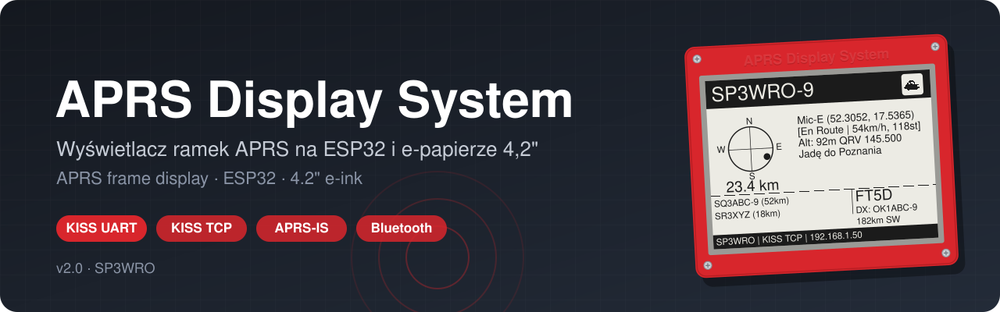
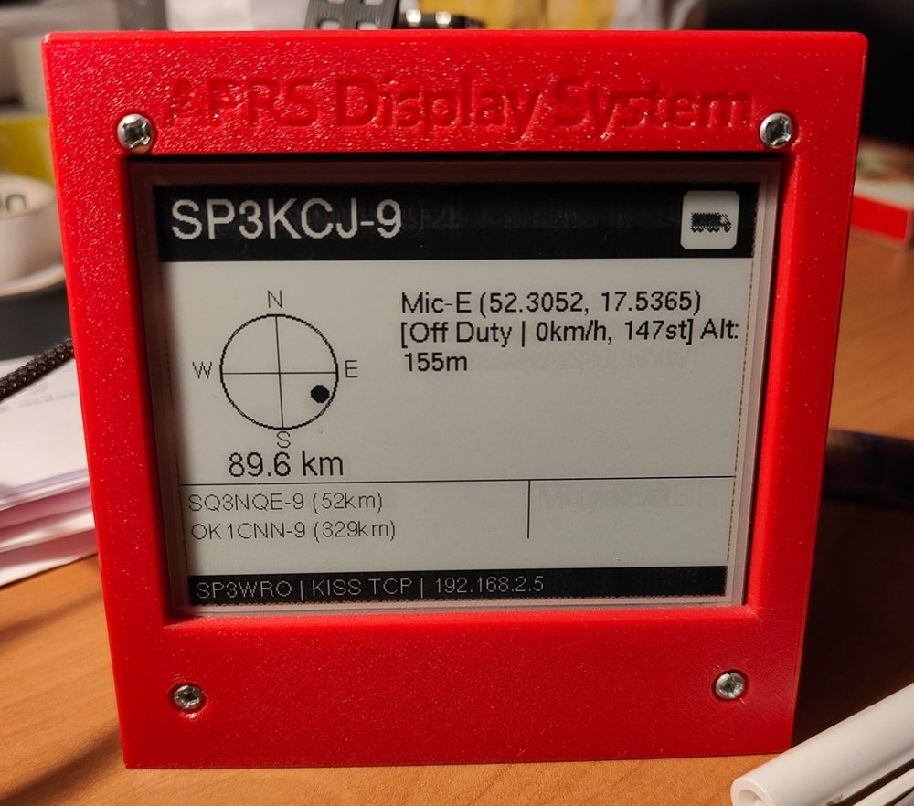
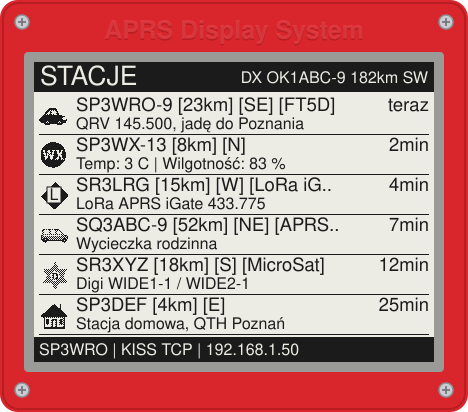
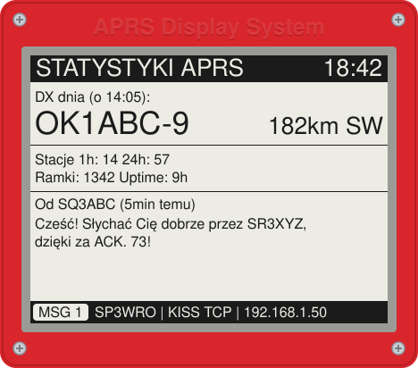
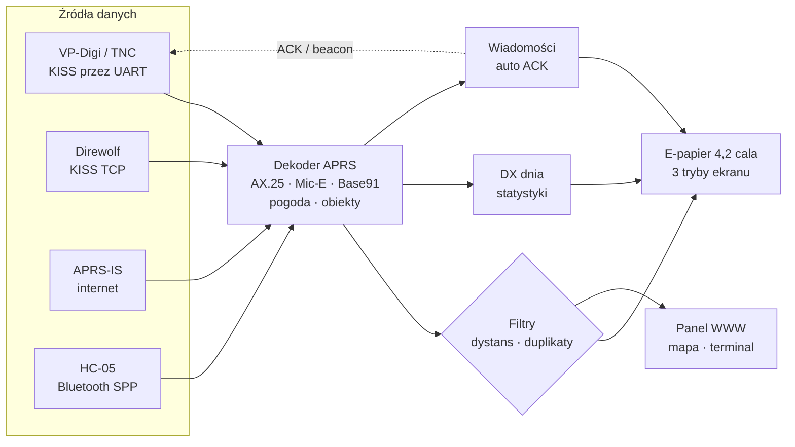
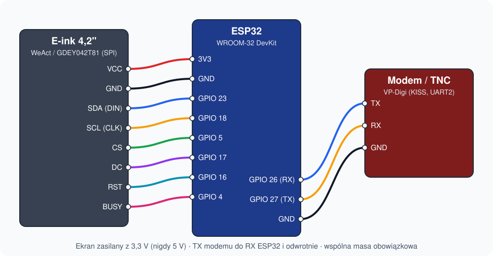

<p align="center">
  
</p>

<p align="center">
  <a href="https://github.com/SP3WRO/APRS_Display_System/actions/workflows/build.yml"></a>
  
  
  
  
</p>

<p align="center">
  <b>🇵🇱 Polski</b> · <a href="README.md">🇬🇧 English</a>
</p>

**APRS Display System** to samodzielny wyświetlacz ruchu APRS zbudowany na ESP32 i energooszczędnym ekranie e-papierowym 4,2". Odbiera ramki z radia (przez modem KISS lub Bluetooth) albo z internetu (APRS-IS), dekoduje je i pokazuje to, co najważniejsze: kto nadaje, jak daleko i w którą stronę, czym jedzie i co ma do powiedzenia. Konfiguracja i podgląd na żywo są w przeglądarce, bez instalowania czegokolwiek.

<p align="center">
  
</p>

---

## Spis treści
- [Funkcje](#funkcje)
- [Tryby ekranu](#tryby-ekranu)
- [Jak to działa](#jak-to-działa)
- [Sprzęt](#sprzęt)
- [Schemat połączeń](#schemat-połączeń)
- [Instalacja](#instalacja)
- [Pierwsze uruchomienie](#pierwsze-uruchomienie)
- [Panel WWW](#panel-www)
- [Szczegóły działania](#szczegóły-działania)
- [Dla programistów](#dla-programistów)
- [Licencja i podziękowania](#licencja-i-podziękowania)

---

## Funkcje

| Funkcja | Opis |
|--|--|
| 📡 **Cztery źródła danych** | Modem VP-Digi (UART/KISS), KISS TCP (np. Direwolf), APRS-IS przez WiFi i Bluetooth SPP (HC-05). |
| 🖥️ **Trzy tryby ekranu** | Klasyczny z kompasem, lista ostatnich stacji i statystyki z DX dnia. Przełączane z panelu od razu, bez restartu. |
| 🧭 **Dystans i kierunek** | Odległość i azymut od Twojej stacji, kompas ze wskazaniem kierunku. |
| 🏷️ **Pełny zestaw symboli APRS** | Około 190 ikon z tabeli podstawowej i alternatywnej oraz nakładki (np. `L#`), takie same jak na aprs.fi. |
| 🏆 **DX dnia** | Najdalsza stacja słyszana bezpośrednio (bez digipeaterów), zerowana o północy. |
| ✉️ **Wiadomości APRS** | Odbiór z automatycznym potwierdzeniem (ACK) i wysyłanie z przeglądarki z ponawianiem aż do potwierdzenia. |
| 🔤 **Polskie litery** | Czcionki zaprojektowane piksel po pikselu, ostre na e-papierze, z pełnym zestawem polskich znaków. |
| 🌐 **Panel WWW i mapa** | Wszystkie ustawienia, statystyki, wiadomości, terminal na żywo i mapa słyszanych stacji. |
| 📍 **Beacon** | Własna pozycja z wybranym symbolem i komentarzem, przez radio albo APRS-IS. |
| 🚨 **EMCOM** | Ramki EMERGENCY omijają wszystkie filtry i wyświetlają alarm na ekranie. |
| 🛡️ **Odporność na awarie** | Powrót do WiFi po awarii routera, awaryjna sieć konfiguracyjna, wykrywanie zerwanego połączenia, przyczyna ostatniego restartu na ekranie. |

---

## Tryby ekranu

<table>
  <tr>
    <td align="center" width="33%"></td>
    <td align="center" width="33%"></td>
    <td align="center" width="33%"></td>
  </tr>
  <tr>
    <td valign="top"><b>Klasyczny</b><br>Znak i symbol ostatniej stacji, kompas z kierunkiem, dystans, zdekodowane dane (albo surowa ramka lub sam komentarz), dwie poprzednie stacje, model radia i DX dnia.</td>
    <td valign="top"><b>Lista stacji</b><br>Sześć ostatnich stacji z symbolem, dystansem, kierunkiem, modelem radia i czasem od odebrania. DX dnia na pasku tytułowym.</td>
    <td valign="top"><b>Statystyki</b><br>DX dnia z godziną, liczba stacji w ciągu godziny i doby, licznik ramek, czas pracy, zegar i ostatnia wiadomość.</td>
  </tr>
</table>

> Wizualizacje odwzorowują układ z kodu urządzenia (te same współrzędne i ikony). W stopce plakietka **MSG** sygnalizuje nieprzeczytane wiadomości.

---

## Jak to działa



---

## Sprzęt

| Element | Opis |
|--|--|
| **ESP32** | Płytka ESP32-WROOM-32 (DevKit). |
| **Ekran** | WeAct 4,2" e-paper BW, 400×300 px (sterownik GDEY042T81), SPI. |
| **Źródło danych** *(jedno z)* | Modem VP-Digi lub inny TNC KISS · Direwolf w sieci · dostęp do internetu (APRS-IS) · moduł HC-05 przy radiu. |
| **Obudowa** | Drukowana w 3D, pliki `case/1.stl` i `case/2.stl` (projekt: Patryk Starzonek). |
| **Zasilanie** | 5 V przez USB. |

<p align="center">
  
  
</p>

> 💡 **Zasilanie:** przy starcie WiFi ESP32 pobiera chwilowo kilkaset mA. Program ogranicza te szczyty (mniejsza moc nadajnika WiFi, CPU 160 MHz), ale jeśli urządzenie zgłasza przy starcie „SPADEK NAPIĘCIA”, pomoże kondensator 470–1000 µF między 3,3 V a GND przy ESP32 oraz krótki, gruby kabel USB.

---

## Schemat połączeń

<p align="center">
  
</p>

<details>
<summary><b>Tabele połączeń</b></summary>

**Ekran e-ink ↔ ESP32** (SPI)

| Pin ekranu | Pin ESP32 | Funkcja |
|--|--|--|
| VCC | 3,3 V | Zasilanie logiki ekranu, **nigdy 5 V** |
| GND | GND | Wspólna masa |
| SDA (DIN) | GPIO 23 | Dane (sprzętowe SPI, MOSI) |
| SCL (CLK) | GPIO 18 | Zegar (sprzętowe SPI, SCK) |
| CS | GPIO 5 | `EPD_CS` |
| DC | GPIO 17 | `EPD_DC` |
| RST | GPIO 16 | `EPD_RST` |
| BUSY | GPIO 4 | `EPD_BUSY` |

**Modem VP-Digi / TNC ↔ ESP32** (UART2, połączenie na krzyż)

| Pin modemu | Pin ESP32 | Funkcja |
|--|--|--|
| TX | GPIO 26 | `VP_RX_PIN`, ESP32 odbiera ramki |
| RX | GPIO 27 | `VP_TX_PIN`, ESP32 wysyła beacon, ACK i wiadomości |
| GND | GND | Wspólna masa – obowiązkowa |

**Bluetooth (HC-05)** – moduł łączysz przewodami RX/TX z modemem przy radiu (np. port DATA), a ESP32 łączy się z nim bezprzewodowo po adresie MAC z panelu. W trybie Bluetooth WiFi jest wyłączone.

</details>

---

## Instalacja

1. **Pobierz projekt** (Code → Download ZIP albo `git clone`) i **zmień nazwę folderu na `APRS_Display_v2`**.
   > Arduino IDE wymaga, żeby folder nazywał się tak jak główny plik `APRS_Display_v2.ino`. Przy innej nazwie IDE przeniesie sam plik `.ino` i reszta projektu przestanie być widoczna.
2. **Zainstaluj biblioteki** (Narzędzia → Zarządzaj bibliotekami):
   - `GxEPD2`
   - `Adafruit GFX Library`
   - `U8g2_for_Adafruit_GFX`
3. **Zainstaluj obsługę ESP32** (Espressif, testowane na 3.3.x) i wybierz swoją płytkę ESP32.
4. **Ustaw schemat partycji „Huge APP (3MB No OTA/1MB SPIFFS)”**:
   <p></p>
5. **Otwórz `APRS_Display_v2.ino`** (pozostałe pliki otworzą się jako zakładki), skompiluj i wgraj. Pojawi się ekran startowy z paskiem ładowania i numerem wersji.

> Gotowy plik `.bin` z każdej wersji jest też dostępny jako artefakt w [GitHub Actions](https://github.com/SP3WRO/APRS_Display_System/actions/workflows/build.yml).

---

## Pierwsze uruchomienie

1. Bez skonfigurowanego WiFi urządzenie uruchamia własną sieć **`APRS_DISPLAY_SETUP`** z hasłem **`aprsdisplay`**. Instrukcja zostaje też na ekranie.
2. Połącz się z tą siecią i otwórz **http://192.168.4.1**.
3. Ustaw znak, swoją pozycję, sieć WiFi i źródło danych, a potem kliknij **Zapisz**.
4. Po połączeniu z domową siecią adres panelu jest widoczny w stopce ekranu.

---

## Panel WWW

- **Ustawienia** wszystkich funkcji. Tryb ekranu i format danych zmieniają się **od razu po wybraniu z listy**, a przycisk „Zapisz” restartuje urządzenie tylko przy zmianie połączenia (źródło danych, WiFi, serwer, Bluetooth). Pozostałe zmiany działają natychmiast.
- **Statystyki** – DX dnia, liczba stacji, licznik ramek.
- **Wiadomości** – lista odebranych i wysłanych z potwierdzeniami oraz formularz wysyłania.
- **Mapa stacji** – słyszane stacje na mapie OpenStreetMap z dystansem, radiem i komentarzem (wymaga internetu w przeglądarce).
- **Terminal na żywo** – surowe ramki i logi urządzenia.
- **API JSON** – `/api/status` i `/api/stations` do własnych integracji.
- **Bezpieczeństwo** – hasło sieci awaryjnej i opcjonalne hasło panelu (użytkownik `admin`). Zapisane hasła nigdy nie wracają do przeglądarki.

---

## Szczegóły działania

<details>
<summary><b>📡 Źródła danych</b></summary>

- **VP-Digi UART** – ramki KISS z pinów RX/TX modemu. Bufor 4 KB, więc ramki nie giną podczas odświeżania ekranu.
- **KISS TCP** – klient serwera KISS (np. Direwolf na Raspberry Pi). Obsługiwane są ramki z dowolnego portu TNC.
- **APRS-IS** – passcode liczony automatycznie ze znaku. Filtr serwera budowany z Twojej pozycji i filtra odległości (przy „0 = wył” 100 km) albo własny; zmiana filtra działa bez rozłączania. Zerwane „po cichu” połączenie (brak danych przez 90 s) jest nawiązywane od nowa.
- **Bluetooth SPP** – połączenie z modemem z modułem HC-05. Po trzech nieudanych próbach urządzenie przechodzi w tryb sieci awaryjnej, a po 10 minutach bez nikogo w panelu ponawia Bluetooth.
</details>

<details>
<summary><b>🧩 Dekodowanie ramek</b></summary>

- AX.25 w ramkach KISS, linie APRS-IS, ruch przekazany przez iGate (`}`).
- Pozycje standardowe i skompresowane (Base91 – z kursem, prędkością i wysokością), Mic-E (z wysokością, częstotliwością i statusem), obiekty i itemy, pogoda z pozycją i bez, PHG, statusy, wiadomości.
- Rozpoznawanie radia po TOCALL i sufiksach Mic-E: Yaesu, Kenwood, AnyTone, APRSdroid, Direwolf, aprx, APRSIS32, UI-View, Xastir, MicroSat, LoRa i inne.
</details>

<details>
<summary><b>🏆 DX dnia</b></summary>

- Najdalsza stacja danego dnia, zerowana o północy (czas z NTP, strefa czasowa w panelu).
- Liczy się tylko stacja słyszana **bezpośrednio**: bez digipeatera (żaden adres w ścieżce nie jest oznaczony `*`) i bez ramek przekazanych przez iGate. W trybie APRS-IS – stacja słyszana bezpośrednio przez iGate.
- Obiekty i itemy są pomijane, bo ich pozycja to nie miejsce nadawania.
- DX jest liczony także z ramek odrzuconych przez filtr odległości.
</details>

<details>
<summary><b>✉️ Wiadomości</b></summary>

- Wiadomości do Twojego znaku (albo znaku APRS-IS) są potwierdzane automatycznie (można to wyłączyć); powtórki od nadawcy nie pojawiają się drugi raz.
- Wysyłanie z panelu: do 67 znaków, ponawianie co 30 s, maksymalnie 5 razy, aż do potwierdzenia.
- W eter idzie czysty ASCII (polskie litery są zamieniane), zgodnie ze specyfikacją APRS.
</details>

<details>
<summary><b>🔎 Filtry i beacon</b></summary>

- **Anty-duplikat** – identyczne ramki tej samej stacji w ciągu 10 s są ignorowane.
- **Filtr dystansu** – odrzuca stacje dalsze niż zadany limit (ramki EMERGENCY zawsze przechodzą).
- **Ukrywanie ramek bez pozycji.**
- **Beacon** – pozycja, symbol i komentarz w zadanym odstępie, konfigurowalna ścieżka RF (np. `WIDE1-1,WIDE2-1`), pierwszy beacon minutę po starcie.
</details>

<details>
<summary><b>🛡️ Mechanizmy awaryjne</b></summary>

- **Powrót do WiFi** – gdy router startuje wolniej niż ESP32 (np. po zaniku prądu), urządzenie uruchamia sieć awaryjną i w tle ponawia łączenie z domową siecią. Po odzyskaniu połączenia sieć awaryjna wyłącza się sama.
- **Przyczyna restartu** – po restarcie z powodu błędu (spadek napięcia, błąd programu, watchdog) przyczyna pojawia się na ekranie startowym i w terminalu panelu.
- **Ochrona przed uszkodzonymi ramkami** – krótkie lub błędne ramki nie zawieszają urządzenia (pokrywają to testy).
</details>

---

## Dla programistów

### Struktura projektu

| Plik | Zawartość |
|--|--|
| `APRS_Display_v2.ino` | zmienne globalne, konfiguracja, `setup()`, `loop()` |
| `display.ino` | ekran e-ink: 3 tryby, ekran startowy, symbole APRS |
| `network.ino` | KISS / UART / Bluetooth / TCP / APRS-IS, beacon, filtry, WiFi |
| `messages.ino` | wiadomości z ACK i ponawianiem |
| `stats.ino` | statystyki i DX dnia |
| `web.ino` | panel WWW, mapa, API JSON |
| `aprs_parser.h/.cpp` | dekoder ramek APRS bez zależności sprzętowych |
| `app.h` | wspólne typy, stałe i deklaracje |
| `icons.h` / `icons_aprs.h` | logo startowe / symbole APRS 32×32 |
| `tools/convert-icons.ps1` | generator `icons_aprs.h` z arkuszy symboli |
| `test/` | testy parsera i symboli uruchamiane na PC |
| `case/` | pliki STL obudowy |

### Testy i CI

```bash
g++ -std=c++17 -Itest/arduino_shim -I. test/test_parser.cpp aprs_parser.cpp -o test_parser && ./test_parser
```

Przy każdym pushu [GitHub Actions](https://github.com/SP3WRO/APRS_Display_System/actions/workflows/build.yml) uruchamia testy parsera i kompiluje firmware ESP32, udostępniając gotowy plik `.bin`.

### Plany

- Obsługa przycisków (przewijanie listy, cofanie ramek).

---

## Licencja i podziękowania

- Kod: licencja **GNU GPL v3** – szczegóły w pliku [LICENSE](LICENSE).
- **Symbole APRS** pochodzą z zestawu aprs.fi – [hessu/aprs-symbols](https://github.com/hessu/aprs-symbols) (Heikki Hannikainen OH7LZB i inni autorzy). Licencje poszczególnych symboli opisuje [COPYRIGHT.md](https://github.com/hessu/aprs-symbols/blob/master/COPYRIGHT.md): część jest na CC BY-SA, część to domena publiczna, a licencji części symboli (z klasycznego zestawu UI-View/WA8LMF) autor nie zna. Logo firm (`/M`, `/Z`, `\K`) zostały pominięte. Ikony są przerobione na czarno-białe 32×32 skryptem `tools/convert-icons.ps1`.
- Czcionki: [U8g2](https://github.com/olikraus/u8g2) (Oliver Kraus), sterownik ekranu: [GxEPD2](https://github.com/ZinggJM/GxEPD2) (Jean-Marc Zingg).

## Autorzy

- **Oprogramowanie:** Mateusz SP3WRO – czysty61@gmail.com
- **Obudowa:** Patryk Starzonek – patrykst1999@o2.pl

<p align="center"><sub>73 de SP3WRO</sub></p>
